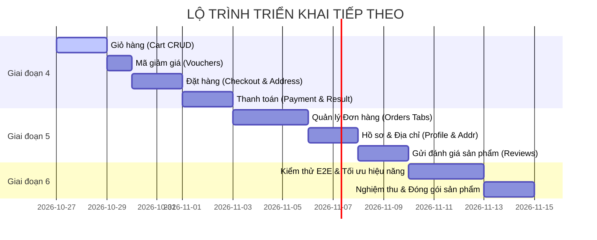

# TÀI LIỆU TOÀN DIỆN VỀ DỰ ÁN (PROJECT MASTER PLAN & AI HANDOFF)

> **Mục đích tài liệu**: Tài liệu này đóng vai trò là "Single Source of Truth" bàn giao cho bất kỳ AI agent hoặc kỹ sư phần mềm nào tiếp quản dự án `ProjectTBDD`. Tài liệu mô tả toàn bộ kiến trúc, công nghệ, hiện trạng đã làm, các cạm bẫy kỹ thuật đã giải quyết, và lộ trình chi tiết các giai đoạn tiếp theo.

---

## 1. TỔNG QUAN DỰ ÁN & BỐI CẢNH (PROJECT OVERVIEW)

### 1.1. Mục tiêu
Xây dựng lại toàn bộ giao diện và luồng người dùng của ứng dụng thương mại điện tử di động (React Native / Expo / TypeScript) với phong cách trải nghiệm mua sắm hiện đại tương tự **Shopee**, nhưng sở hữu bộ nhận diện thương hiệu độc bản:
- **Phong cách thị giác (Design Language)**: Màu pastel thanh lịch, bo góc lớn (pill / rounded-xl), typography hiện đại (Plus Jakarta Sans), hiệu ứng dải cực quang phát sáng (Aurora Background) chuyển động mượt mà.
- **Tính tương thích đa nền tảng**: Hoạt động đồng bộ 100% trên cả 3 môi trường:
  1. Trình duyệt Web (`http://localhost:8081`) - Giới hạn khung hình mô phỏng điện thoại (`maxWidth: 480px`, căn giữa màn hình).
  2. Máy ảo Android (Android Emulator, kết nối API qua `http://10.0.2.2:8080`).
  3. Điện thoại thật qua Expo Go (kết nối qua IP LAN máy tính).
- **Ngôn ngữ giao diện**: Tiếng Anh (English) thống nhất toàn bộ chuỗi UI trong `src/constants/strings.ts`.
- **Tên ứng dụng**: **E-Shop** (Không dùng chuỗi nhãn hiệu bên thứ ba).

### 1.2. Quy tắc cốt lõi (Non-negotiable Rules)
1. **Backend là Nguồn Sự Thật (Source of Truth)**:
   - Toàn bộ trường dữ liệu và tên endpoint bắt buộc khớp 100% với Spring Boot DTO/Controller. Tuyệt đối **không bịa API**, không suy đoán trường dữ liệu.
   - Frontend phải thích ứng linh hoạt với cấu trúc dữ liệu backend trả về (kể cả các hạn chế hay thiếu sót).
2. **Quy tắc bất khả xâm phạm backend**:
   - Backend thuộc trạng thái Read-Only. Ngoại lệ duy nhất đã được cấp phép và hoàn thành ở Giai đoạn 3.2 (sửa điều kiện soft-delete trong `ProductRepository` và `ProductService`). Từ Giai đoạn 4 trở đi, **tuyệt đối không sửa code Java, SQL hay file cấu hình backend**.

---

## 2. STACK CÔNG NGHỆ & MÔI TRƯỜNG CHẠY (TECH STACK & RUNTIME)

### 2.1. Frontend (`apps/mobile`)
- **Framework**: React Native 0.86.3, React 19.2.3, Expo SDK ~57.0.27.
- **Ngôn ngữ**: TypeScript ~6.0.3.
- **Thư viện điều hướng (Navigation)**: `@react-navigation/native-stack` v7.20, `@react-navigation/bottom-tabs` v7.20. Hỗ trợ đầy đủ Deep Linking và Modal navigation.
- **Quản lý dữ liệu & Cache**: `@tanstack/react-query` v5.104 (quản lý server state, infinite query, cache invalidation).
- **HTTP Client**: `axios` v1.20 với custom interceptor:
  - Tự động đính kèm `Bearer JWT`.
  - Hàng đợi refresh token tự động (Token Refresh Queue Pattern khi gặp HTTP 401).
  - Serializer mảng tùy chỉnh: `paramsSerializer: { indexes: null }` để Spring Boot tiếp nhận query multi-sort `sort=a&sort=b`.
- **Lưu trữ Token**: `expo-secure-store` (trên iOS/Android) và `localStorage` (trên Web) thông qua wrapper trừu tượng `tokenStorage.ts`.
- **UI & Graphics**:
  - `expo-linear-gradient`: Dựng dải màu chuyển tiếp Aurora và Card gradients.
  - `react-native-svg`: Render đồ họa vector, các blob phát sáng của cực quang.
  - `@expo/vector-icons` (Ionicons): Bộ icon xuyên suốt ứng dụng.
  - `@expo-google-fonts/plus-jakarta-sans`: Phông chữ tiêu chuẩn hệ thống.
  - `react-native-web` v0.21: Render mượt mà trên browser.

### 2.2. Backend (`services/ecommerce-service`)
- **Công nghệ**: Spring Boot 3.3.5, Java 21, Maven 3.9.9.
- **Cơ sở dữ liệu**: MySQL 8.x chạy trên cổng mặc định `3306` (Docker container `ecommerce-mysql`).
- **Bộ nhớ đệm (Caching)**: Redis 7.x (Docker container `ecommerce-redis`) với cơ chế Cache-Aside (TTL 10 phút, tự động xoá khi tạo/sửa).
- **Reverse Proxy & Load Balancer**: Nginx Alpine (Docker container `ecommerce-nginx`) chạy trên cổng `80`, cấu hình Gzip nén payload, CORS headers toàn cục và Rate Limiting 50 req/s.
- **API Gateway trung tâm**: Spring Cloud Gateway (`api-gateway`) chạy trên cổng `8080` (sử dụng Netty WebFlux phản ứng nhanh), định tuyến toàn bộ các luồng Auth, Product, Order, Payment về backend service (cổng `8081`), tích hợp bộ lọc toàn cục `LoggingAndTrackingFilter`.
- **Tìm kiếm thông minh (Full-Text Search)**: Elasticsearch 8.13 (Docker container `ecommerce-elasticsearch`) trên cổng `9200`, hỗ trợ đánh chỉ mục sản phẩm và tìm kiếm mờ (Fuzzy matching `fuzziness: AUTO`), khắc phục lỗi chính tả của người dùng.
- **Message Broker & Saga Pattern**: Apache Kafka (Docker container `ecommerce-kafka` chạy chế độ KRaft không cần Zookeeper) với 2 topic `order-events` và `payment-events`. Khi thanh toán thất bại, sự kiện `PaymentFailedEvent` phát qua Kafka kích hoạt `StockCompensationConsumer` tự động hoàn trả tồn kho sản phẩm trong `product_db`.
- **Công cụ đo tải (Benchmarking)**: k6 (Grafana k6 Docker) với bộ kịch bản kiểm thử hiệu năng cao `scripts/k6-loadtest.js`.
- **Kiến trúc dữ liệu đặc biệt (Multi-DataSource Architecture)**:
  - Hệ thống sử dụng 4 Database/Schema độc lập trên cùng 1 MySQL instance:
    1. `auth_db`: Quản lý tài khoản, phân quyền, địa chỉ người dùng.
    2. `product_db`: Quản lý danh mục cha-con, sản phẩm, biến thể SKU, ảnh, đánh giá (reviews).
    3. `order_db`: Quản lý giỏ hàng (Cart), đơn hàng (Order), Voucher giảm giá.
    4. `payment_db`: Quản lý giao dịch thanh toán (Payment, Transactions).
  - Mỗi domain sở hữu DataSource, EntityManagerFactory và `PlatformTransactionManager` riêng (`authTransactionManager`, `productTransactionManager`, `orderTransactionManager`, `paymentTransactionManager`).
- **Bảo mật (Security)**: Spring Security (stateless), JWT HMAC-SHA256 (access token 15 phút, refresh token 7 ngày), BCryptPasswordEncoder.
- **Tài liệu API**: OpenAPI 3 / Swagger tại `http://localhost:8080/swagger-ui`.

---

## 3. CÁC CẠM BẪY KỸ THUẬT & PHÁT HIỆN SỐNG CÒN (CRITICAL LESSONS & PITFALLS)

Dành riêng cho AI / Developer tương lai để **không bao giờ lặp lại các lỗi nghiêm trọng sau**:

| Vấn đề | Chi tiết cạm bẫy | Giải pháp chuẩn mực đã áp dụng |
|---|---|---|
| **Lỗi 500 khi Sort giá / rating** | JPA Entity dùng trường `minPrice` và `ratingAvg`, KHÔNG có cột `price` hay `rating`. Nếu request `?sort=price,asc` -> Backend crash HTTP 500. | Frontend bắt buộc dùng các hằng số trong `src/constants/sort.ts`: `minPrice,asc`, `minPrice,desc`, `ratingAvg,desc`, `soldCount,desc`, `viewCount,desc`. |
| **Mất ổn định khi phân trang (Tie-breaker)** | Khi các sản phẩm có cùng `soldCount` hoặc `ratingAvg`, thứ tự giữa các trang bị nhảy đảo lộn. | Luôn bọc qua hàm `withStableSort()` để tự động thêm tiêu chí phụ `id,asc`. |
| **Axios mảng query params** | Axios mặc định chuyển mảng sort thành `sort[]=soldCount,desc` khiến Spring Boot Data Pageable không nhận diện được. | Cấu hình `paramsSerializer: { indexes: null }` trong `src/api/client.ts` để sinh ra `sort=soldCount,desc&sort=id,asc`. |
| **Tràn mép màn hình trên Web (Cắt nút)** | Khổ rộng SVG Aurora trên trình duyệt vô tình kéo dãn container web ra 1560px, làm các nút mép phải (nút Giỏ hàng, Bộ lọc, Nút Add to Cart) trôi ra ngoài viewport. | Bọc toàn bộ app trong `App.tsx` bằng `appFrame` có `maxWidth: 480, overflow: 'hidden'` và dùng hook `useContentWidth()`. |
| **Ảnh 404 từ backend** | Backend lưu đường dẫn ảnh dạng `/images/products/...` nhưng máy chủ không chứa static file thật. | Dùng component `RemoteImage.tsx`: Tự động hiển thị fallback pastel bo góc với icon ảnh và 2 chữ cái viết tắt tên sản phẩm (vd: `HS` cho Hoodie shirt, `RS` cho Red Sneakers). |
| **Danh mục gốc trả về rỗng** | Sản phẩm được gắn vào danh mục con (Hoodies, Shoes, Laptops...), trong khi Home gọi theo ID danh mục gốc (Electronics, Fashion...). | Đã hotfix backend (Giai đoạn 3.2): truy vấn lấy toàn bộ cây con cháu bằng `findByPathStartingWith` kết hợp `findByCategoryIdInAndDeletedAtIsNullAndStatus`. |
| **Dữ liệu danh sách thiếu trường** | DTO `ProductListResponse` **KHÔNG** chứa `images`, `categoryId`, `description`, `discountPercent`. | Chỉ hiển thị các trường backend thật sự trả về; tính phần trăm giảm giá ở client nếu có cả `originalPrice` và `price`. |

---

## 4. BẢNG TIẾN ĐỘ & HIỆN TRẠNG CHI TIẾT (WHAT HAS BEEN DONE)

Dự án được chia làm 6 giai đoạn lớn. Hiện tại **đã hoàn thành xuất sắc Giai đoạn 1, 2, 3.1, và 3.2**.

```mermaid
flowchart LR
    G1["Giai đoạn 1: Design System & Core"] --> G2["Giai đoạn 2: Auth Flow & Aurora"]
    G2 --> G3["Giai đoạn 3: Catalog, Detail, Reviews"]
    G3 --> G4["Giai đoạn 4: Cart, Checkout & Payment"]
    G4 --> G5["Giai đoạn 5: Orders, Reviews & Profile"]
    G5 --> G6["Giai đoạn 6: Polish & E2E Verification"]
    
    style G1 fill:#D4EDDA,stroke:#28A745,color:#155724
    style G2 fill:#D4EDDA,stroke:#28A745,color:#155724
    style G3 fill:#D4EDDA,stroke:#28A745,color:#155724
    style G4 fill:#D4EDDA,stroke:#28A745,color:#155724
    style G5 fill:#D4EDDA,stroke:#28A745,color:#155724
    style G6 fill:#FFF3CD,stroke:#FFC107,color:#856404
```



### 4.1. Giai đoạn 1 – Design System, Token & Hạ tầng (ĐÃ DUYỆT)
- [x] Xây dựng trọn vẹn bộ Theme Tokens: `colors.ts`, `spacing.ts`, `radius.ts`, `shadows.ts`, `typography.ts`.
- [x] Tạo các UI Components chuẩn mực: `Typography`, `Button` (Primary tím đậm chữ trắng, Soft pastel chữ ink, Outlined), `Input`, `Badge`, `Skeleton`, `ProductCard`, `ProductListItem`, `RemoteImage`.
- [x] Xây dựng Client API Axios + interceptor + tokenStorage (hỗ trợ cả web localStorage và secure store native).
- [x] Thiết kế Floating Tab Bar dạng viên thuốc nổi (`TabNavigator.tsx`) với 4 tab chính + tab Showcase trong `__DEV__`.

### 4.2. Giai đoạn 2 – Authentication & Aurora Background (ĐÃ DUYỆT)
- [x] Phát triển component `AuroraBackground` (cả bản native và `.web.tsx` tối ưu): Dải gradient chuyển động mềm tuần hoàn (-12 độ trượt ngang vô tận không thấy mối nối) kết hợp 3 blob ánh sáng trôi đa tốc độ.
- [x] Hoàn thiện màn hình `LoginScreen.tsx` và `RegisterScreen.tsx`.
- [x] Tích hợp `AuthContext` quản lý vòng đời đăng nhập, đăng xuất, lưu token, load user profile qua `/api/v1/auth/me`.
- [x] Sửa triệt để hiện tượng autofill browser làm sai màu ô nhập bo tròn trên Web.

### 4.3. Giai đoạn 3 (3.1 & 3.2) – Catalog, Search, Chi tiết sản phẩm & Review thật (ĐÃ HOÀN TẤT)
- [x] **Home Screen (`HomeScreen.tsx`)**:
  - Dải cực quang Aurora phủ phần trên cùng (~230px) chứa thanh tìm kiếm "Search products", nút Giỏ hàng với Badge đỏ, và Hero Banner sản phẩm giảm giá sâu nhất (lấy tự động bằng `discountPercent,desc`).
  - Danh mục bo tròn với icon Ionicons tương ứng theo slug (`Electronics` -> 9 sản phẩm, `Fashion` -> 3 sản phẩm, `Beauty` -> 1 sản phẩm, `Fresh Fruits` -> 6 sản phẩm).
  - Hàng cuộn ngang "Best Sales" và "Popular" (sắp xếp chuẩn xác theo `viewCount,desc`).
  - Lưới "Recommended for You" với Infinite Scroll phân trang ổn định.
- [x] **Search & Catalog Screen (`SearchScreen.tsx`)**:
  - Thanh tìm kiếm thời gian thực (debounce 400ms).
  - Chip lọc danh mục: `In Category: <Tên>` với nút xoá nhanh (x).
  - 4 Tab sắp xếp: `Best Sales`, `Popular`, `Price ⇅`, `Rating`.
  - Nút mở Modal lọc giá min/max và nút chuyển đổi chế độ xem Grid (2 cột) / List (1 cột).
- [x] **Chi tiết sản phẩm (`ProductDetailScreen.tsx`)**:
  - Carousel ảnh sản phẩm khớp khít với khung app `useContentWidth()`, 2 nút Back & Cart tròn nổi trên ảnh.
  - Hiển thị giá to rõ, nhãn giảm giá `-%`, số sao, lượt bán, tồn kho tổng, mô tả thu gọn/mở rộng.
  - **Review thật từ backend**: Lấy dữ liệu thật từ `/api/v1/products/{id}/reviews`, render avatar tròn chữ cái đầu pastel, họ tên, biểu tượng cảm xúc (😄, 😐, 🙁), tag chips (Service, Delivery...), thời gian tương đối ("6 days ago").
  - **Biến thể sản phẩm (Variant Sheet)**:
    - Sắp xếp chuẩn thứ tự size: `XS, S, M, L, XL, XXL`.
    - Chấm màu trực quan cho từng mã màu (`Red`: `#A31F1F`, `Orange`: `#E8380D`, `Blue`: `#4169E1`).
    - Tự động chọn tổ hợp hợp lệ còn hàng đầu tiên (vd: `Red / XS`, Stock: 50).
    - Biến thể hết hàng tự động làm mờ và khoá nút Confirm.
  - Thanh tác vụ cố định đáy: Nút Cart, nút "Add to Cart" pastel, nút "Buy Now" tím đậm.
- [x] **Script kiểm thử tự động (`scripts/check-api.ts`)**:
  - 14/14 endpoint HTTP pass 200.
  - Kiểm tra cấu trúc review thật -> PASS.
  - Kiểm tra số lượng sản phẩm từng danh mục (1: 9, 2: 3, 3: 1, 4: 6) -> MATCHES.
  - Kiểm tra `sort=price,asc` trả về HTTP 500 -> EXPECTED-FAIL.
  - Kiểm tra multi-sort `soldCount,desc&sort=id,asc` -> PASS.
  - Kiểm tra thứ tự Popular theo lượt xem `viewCount` -> MATCHES.
- [x] **Bộ ảnh chụp đối chứng**: Chụp trọn vẹn 10 ảnh màn hình ở cả 2 kích thước 390px (mobile) và 1440px (desktop) lưu tại `T:\ProjectTBDD\screenshots`.

---

## 5. KẾ HOẠCH CHI TIẾT CÁC BƯỚC TIẾP THEO (MASTER ROADMAP)

Bản kế hoạch chi tiết cho các giai đoạn tiếp theo để hoàn thiện 100% ứng dụng:



### 5.1. Giai đoạn 4: Luồng Giỏ Hàng, Đặt Hàng & Thanh Toán (Cart, Checkout & Payment Flow)
*Đây là nhiệm vụ trọng tâm chuẩn bị thực hiện ngay sau khi được duyệt.*

1. **Màn hình Giỏ hàng (Cart Screen / Drawer)**:
   - **Endpoint**:
     - `GET /api/v1/cart`: Lấy giỏ hàng của user hiện tại.
     - `POST /api/v1/cart/items`: Thêm sản phẩm/biến thể.
     - `PUT /api/v1/cart/items/{itemId}`: Cập nhật số lượng (+ / -).
     - `DELETE /api/v1/cart/items/{itemId}`: Xóa từng món.
     - `DELETE /api/v1/cart`: Xóa sạch giỏ hàng.
   - **Xử lý UX**:
     - Danh sách giỏ hàng là danh sách phẳng (`CartResponse` không nhóm theo shop).
     - Checkbox chọn từng món hoặc chọn tất cả để thanh toán.
     - Swipe-to-delete hoặc nút xoá nhanh có hộp thoại xác nhận.
     - Tự động tính tổng tiền tạm tính (Subtotal).

2. **Màn hình Đặt hàng (`CheckoutScreen.tsx`)**:
   - **Dữ liệu địa chỉ nhận hàng**:
     - Lấy danh sách địa chỉ từ `GET /api/v1/addresses`, tự động chọn địa chỉ có `isDefault: true`.
     - Cho phép chọn địa chỉ khác hoặc bấm "Add New Address".
   - **Áp dụng Voucher**:
     - Nhập mã voucher (vd: `WELCOME10`, `FLAT20`, `SUMMER15`).
     - Hiển thị giảm giá trực quan vào bảng kê: Subtotal, Discount, Tax, Fees, Total.
   - **Tạo đơn hàng**:
     - Gọi `POST /api/v1/orders` với body:
       ```json
       {
         "addressId": 1,
         "voucherCode": "WELCOME10",
         "note": "Giao giờ hành chính",
         "paymentMethod": "VISA"
       }
       ```
     - Nhận về `OrderResponse` với trạng thái `PENDING_PAYMENT`.

3. **Màn hình Thanh toán (`PaymentScreen.tsx`) & Thành công (`SuccessScreen.tsx`)**:
   - Chọn phương thức: `VISA`, `MAESTRO`, `PAYPAL` (enum `PaymentMethod` của backend).
   - Form nhập thẻ tín dụng mô phỏng (Card Number, Holder Name, Expiry MM/YY, CVV) hoặc Paypal Email.
   - Gọi `POST /api/v1/payments`:
     - Nếu thẻ kết thúc bằng `0000` -> Báo lỗi thất bại (giả lập logic test backend).
     - Các số thẻ khác -> Trả về `PaymentStatus.COMPLETED`, đơn hàng tự động chuyển sang `PAID`.
   - Điều hướng sang `SuccessScreen` hiển thị mã đơn hàng, tổng tiền, nút "View Order" và "Continue Shopping".

---

### 5.2. Giai đoạn 5: Quản Lý Đơn Hàng, Đánh Giá & Tài Khoản (Orders, Reviews & Profile)

1. **Màn hình Đơn hàng (`OrdersScreen.tsx`)**:
   - Gọi `GET /api/v1/orders` phân trang.
   - Hệ thống tab lọc trạng thái theo Enum backend:
     - `All`: Toàn bộ đơn hàng.
     - `To Pay`: `PENDING_PAYMENT` (kèm nút "Pay Now").
     - `Processing`: `PAID`.
     - `Shipping`: `SHIPPING`.
     - `Completed`: `DELIVERED` (kèm nút "Write Review").
     - `Cancelled`: `CANCELLED`.
   - Cho phép huỷ đơn qua `POST /api/v1/orders/{id}/cancel` khi đơn ở trạng thái chờ.

2. **Viết đánh giá sản phẩm (Review Submission Modal)**:
   - Form đánh giá dựa trên `POST /api/v1/products/{productId}/reviews`:
     - Chọn số sao (1-5).
     - Nhập cảm nghĩ/bình luận (`comment`).
     - Chọn cảm xúc (`emotion`: `GOOD`, `NEUTRAL`, `BAD`).
     - Gắn tag phản hồi (`SERVICE`, `DELIVERY`, `PROMOTION`...).
     - Truyền `orderId` tương ứng.

3. **Màn hình Tài khoản & Địa chỉ (`AccountScreen.tsx`)**:
   - Xem thông tin user từ `GET /api/v1/auth/me`.
   - Cập nhật thông tin: Họ tên, số điện thoại, avatar qua `PUT /api/v1/auth/me`.
   - Quản lý sổ địa chỉ (Thêm, Sửa, Xoá, Đặt làm mặc định qua `/api/v1/addresses`).
   - Nút Đăng xuất với modal xác nhận xóa token an toàn.

---

### 5.3. Giai đoạn 6: Kiểm Thử Toàn Diện, Tối Ưu Hiệu Năng & Bàn Giao (Final Verification & Polish)

1. **Tối ưu hóa hiệu năng**:
   - Memoize các thành phần danh sách `ProductCard`, `CartItem`.
   - Giảm thiểu re-render trên Web khi thay đổi viewport.
2. **Kiểm thử xuyên suốt 3 môi trường**:
   - Web Desktop & Mobile Viewport (Google Chrome / Edge).
   - Máy ảo Android Studio.
   - Điện thoại thật thông qua ứng dụng Expo Go.
3. **Dọn dẹp code**:
   - Ẩn hoàn toàn tab Showcase của `__DEV__` khi build release.
   - Đảm bảo không còn bất kỳ console warning hoặc lint error nào.

---

## 6. HƯỚNG DẪN DÀNH CHO AI TIẾP QUẢN (INSTRUCTIONS FOR FUTURE AI AGENTS)

Khi một AI mới được khởi động trong ngữ cảnh của repo này:

1. **Đọc tài liệu này đầu tiên** (`T:\ProjectTBDD\docs\PROJECT_MASTER_PLAN_AND_HANDOVER.md`).
2. **Kiểm tra trạng thái backend**:
   - Chạy lệnh: `curl.exe -s http://localhost:8080/api/v1/products?size=1`
   - Nếu trả về JSON hợp lệ -> Backend đang chạy tốt trên port 8080.
3. **Kiểm tra trạng thái frontend Metro**:
   - Chạy lệnh: `curl.exe -s http://localhost:8081`
   - Nếu trả về HTML -> Expo Metro đang chạy tốt trên port 8081.
4. **Quy tắc code frontend**:
   - Tất cả styles dùng token từ `src/theme/`.
   - Mọi chuỗi giao diện phải import từ `src/constants/strings.ts`.
   - Luôn sử dụng `RemoteImage` thay vì `<Image>` thuần để đảm bảo hiển thị fallback chữ cái viết tắt pastel khi URL ảnh rỗng hoặc lỗi 404.
5. **Tuyệt đối không sửa backend**: Mọi logic nghiệp vụ phát sinh phải được xử lý khéo léo và thích nghi tại tầng frontend!

